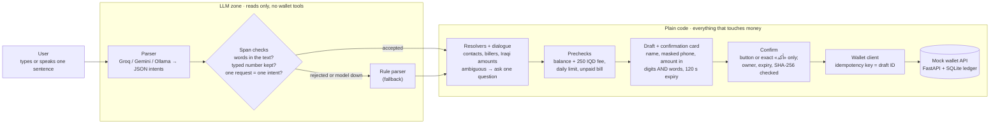
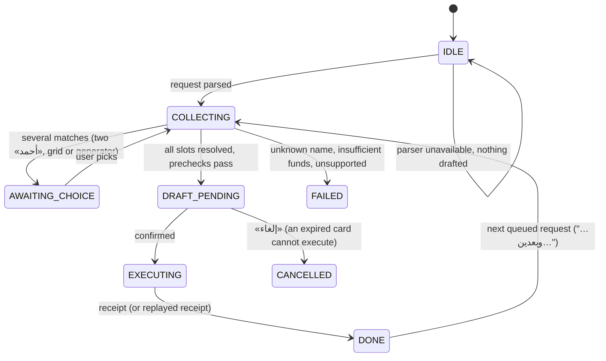
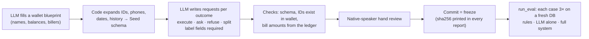

# Architecture

**Design rule: the model reads, the code pays.** The LLM turns one Iraqi-Arabic sentence into structured text spans (who, what, how much). It has no wallet tools, no IDs and no amounts in IQD. Everything that touches money — resolving names, checking balances, confirming, executing — is plain, tested Python.

## Runtime path

A reply lost after the debit is retried with the **same** key; the wallet replays the stored result, so the receipt is the real one and the user is charged once.

## Conversation states

State is persisted per conversation, so a restart resumes where the user was.

## Modules

| Package | Responsibility | Key files |
|---|---|---|
| `agent/` | Understanding and dialogue. No direct database writes to money. | `parser.py` (rule parser, span checks, fallback, provider selection) · `hosted_client.py` (Groq/Gemini) · `ollama_client.py` (local) · `resolvers.py` · `amounts.py` · `dialogue.py` · `confirm.py` (the only path that executes) · `wallet_client.py` (retries, same key) · `messages_ar.py` |
| `wallet_api/` | The mock wallet: ledger, balances, idempotency, fault injection for demos. | `routes.py` · `idempotency.py` · `faults.py` · `models.py` |
| `app.py` | Composes agent + wallet over an in-process HTTP transport; serves the RTL UI. | `ui/index.html` |
| `data/` | Synthetic data and test sets. | `synthetic.py` (generation pipeline) · `generate_mock_data.py` (CLI, never overwrites) · `models.py` (schemas, label checks) · `review.py` / `review_web.py` (native-speaker review: spreadsheet or web page, both validate before writing) · `seed.json` + `testset.jsonl` (development) · `heldout*` (held-out) |
| `eval/` | Evaluation and rehearsal. | `run_eval.py` · `rehearse.py` · `report*.md` |
| `voice/` | Optional speech-to-text; transcript always shown. | `asr.py` |

## Safety invariants

| # | Invariant | Enforced in | Proven by |
|---|---|---|---|
| 1 | Nothing executes without explicit confirmation | `Confirmer.confirm` is the only call to `WalletClient.execute` | static AST test, `tests/test_confirm.py` |
| 2 | Ambiguity is asked, never guessed | `resolvers.rank`: non-exact or close matches always ask | `tests/test_dialogue.py::test_ahmed`, `::test_electricity` |
| 3 | A retry never pays twice | `(user, key)` unique constraint, stored result replay, draft UUID as key | `tests/test_idempotency.py`, 50 concurrent requests |
| 4 | Model output is grounded in the user's words | `check_spans`: spans must be in the text, typed numbers kept, one name per intent | `tests/test_parser.py` |
| 5 | A stale or tampered card cannot execute | owner, pending state, 120 s expiry, SHA-256 of the payload | `tests/test_confirm.py::test_invalid_draft` |
| 6 | Voice never confirms | spoken «أكد» is just text; only the button or a typed exact token confirms | `tests/test_voice.py` |
| 7 | Tests never call a real model | `tests/conftest.py` pins `LLM_PROVIDER=rule` | the suite runs offline |
| 8 | A busy model never makes the user wait | `HostedClient(max_wait=3)` in the app, rule fallback | `tests/test_ollama.py::test_interactive_budget_falls_back_instead_of_waiting` |
| 9 | The wallet has no public door | the wallet API trusts `user_id`, so it is reached in-process only and never mounted on the web app (a mount found in review let one unauthenticated POST pay without a card; removed) | `tests/test_confirm.py::test_wallet_not_reachable_from_outside` |

## Model layer

| Provider | Use | Setting |
|---|---|---|
| Groq `openai/gpt-oss-120b` | development, evaluation, data generation (free, strict JSON schema) | `LLM_PROVIDER=groq`, `GROQ_API_KEY` |
| Gemini Flash / Flash-Lite | Arabic checks, a second opinion | `LLM_PROVIDER=gemini`, `GEMINI_API_KEY` |
| Ollama `qwen3.5:4b` | offline, unlimited, private | `LLM_PROVIDER=ollama` |
| Rule parser | fallback for every provider; offline default | `LLM_PROVIDER=rule` |

All hosted providers go through one OpenAI-compatible client, so switching is a setting. The UI badge shows which parser understood each request.

**Free-tier budget (measured).** Every Groq free model allows 8,000 tokens/min, 1,000 requests/day and **200,000 tokens/day**. One parse is about 1,500 tokens (mostly the fixed prompt), so the real ceiling is about 130 parses a day: tokens per request is the lever, not the model. The parser asks for low reasoning effort (same answers; reasoning tokens 318 → 129; about 0.8 s per reply). In the app a model call gets **3 s** (`LLM_MAX_WAIT`); if it is rate-limited longer the rule parser answers immediately. Evaluation and data generation wait patiently instead. Evaluation calls the model once per distinct text (temperature 0) and keeps every raw answer in `eval/llm-cache/`, so the k=3 runs and the LLM-alone/full-system reports share one call, and a run cut off by the daily quota resumes the next day. An outage is typed (`ProviderError`), counted apart from model mistakes, and makes the report invalid instead of silently measuring the rule fallback. A two-model consensus (gpt-oss + qwen) was tried and dropped: it did not change any result it was meant to fix and doubled free-tier use.

## Data and evaluation pipeline

- **Development set** (`data/testset.jsonl`, 68 requests): may be used to tune prompts and code.
- **Held-out set** (`data/heldout.jsonl`): generated, reviewed and frozen before tuning; never tuned on. The previous held-out set was used to find fixes, so it is archived as `heldout_v1*` and its post-fix reports are labelled `-postfix`.
- **Primary metric:** wrong payments (target 0, a hard gate), then task success, correct questions vs over-asking, latency.

## Configuration

Settings live in an untracked `.env` (see `.env.example`); shell variables win. Keys never go to GitHub.
